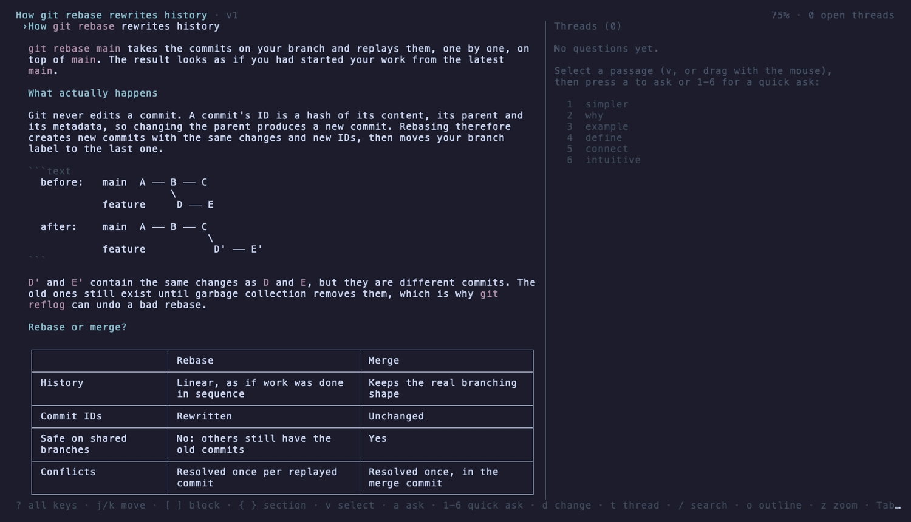
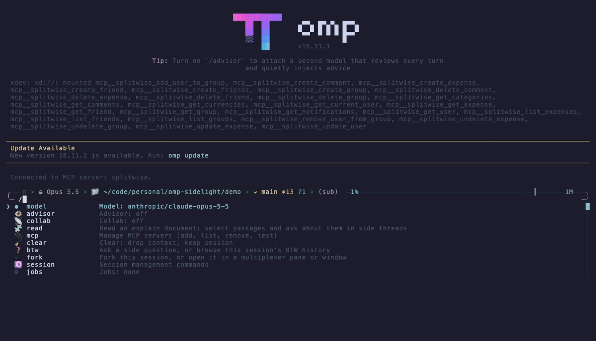
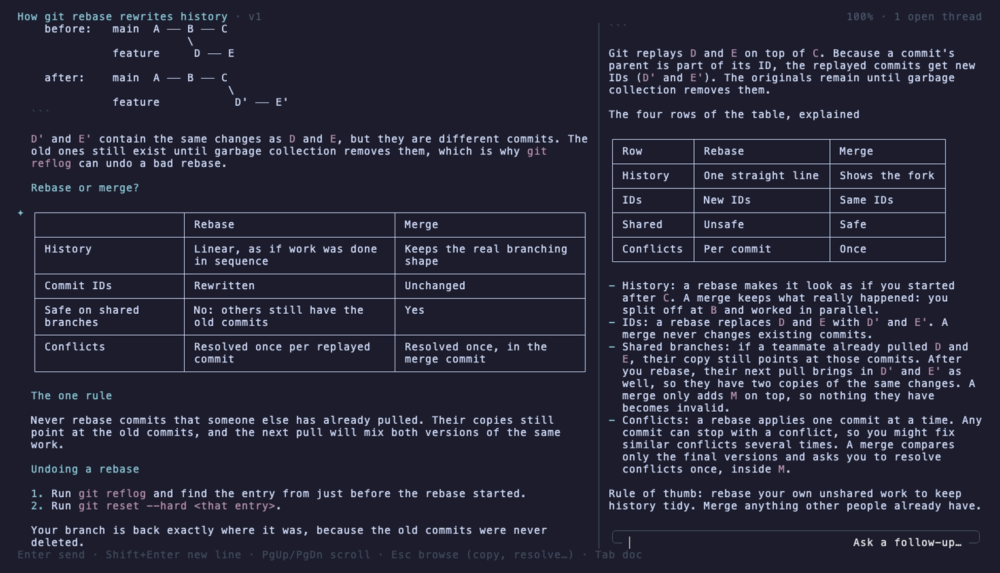
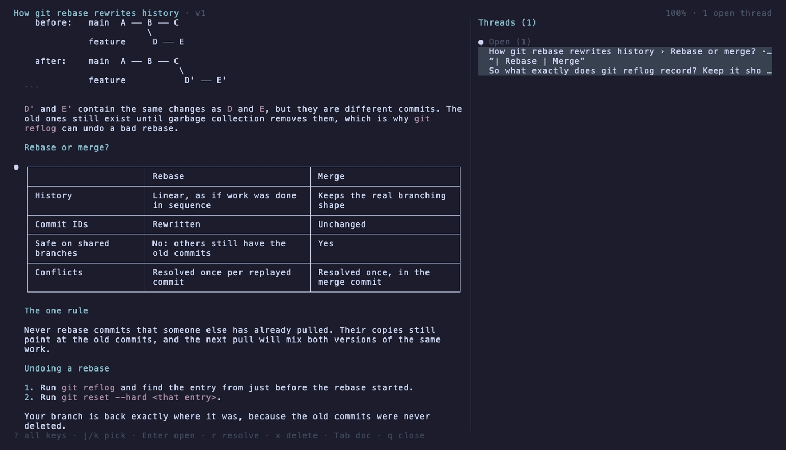
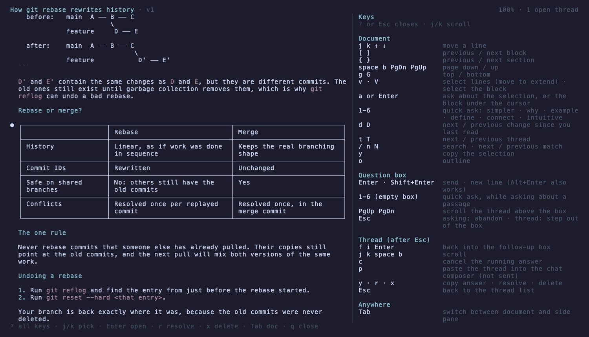

# Sidelight

**A side light on whatever your omp agent explains.** Read long explanations full-screen, and go off on a tangent about any passage in a side thread that never enters your conversation.



When an answer would be long, the agent writes it as a markdown document instead of printing it into the chat. You open it with `/read` (or `ctrl+n`), select any sentence, table or paragraph, and ask about it. The answer arrives in a side thread that knows your whole conversation, but nothing you ask there is added to it, so your main context stays clean.

- **Ask about exactly what you're reading.** Select lines with the keyboard or the mouse, press `a` to type a question, or `1`–`6` for a quick ask.
- **Revisions without rereading.** The agent edits the document in place. The reader marks what changed since you last read, and `d` jumps between the changes.
- **Threads stay attached to their passage**, even when the document is edited. A thread whose passage was rewritten moves to "Passage changed".
- **It looks like omp.** It uses omp's own markdown renderer, chat composer and loader.

## Install

You need [omp](https://github.com/can1357/oh-my-pi) 18.11 or newer.

```sh
omp plugin install github:Mannan-Goyal/omp-sidelight
```

Then restart omp. Or, from inside omp, add the repository as a marketplace:

```text
/marketplace add Mannan-Goyal/omp-sidelight
/marketplace install sidelight@omp-sidelight
```

To uninstall: `omp plugin uninstall omp-sidelight`.

## First run

The first time you open the reader, it offers a two-minute guided tour. The tour opens a sample document and walks you through every feature, moving on only after you've actually tried each step. Replay it any time with `/read tour`, or press `?` in the reader for every key.



## Using it

1. **Ask for an explanation as usual.** When the reply would be long, the agent calls the plugin's `explain` tool. It writes a document, and the chat shows a short summary with a `📖` line.
2. **Open it** with `/read` or `ctrl+n`. With several documents, you pick one from a list.
3. **Read, select, ask.** Answers stream into the side pane on the right.

`/read` also opens:

| Command | Opens |
|---|---|
| `/read` | the agent's documents, newest first, then saved replies, then files you opened before |
| `/read last` | the agent's latest chat reply, as a document |
| `/read notes.md` | any markdown file |
| `/read tour` | the guided tour |

The agent decides when to write a document; you can also ask for one ("write this up as an explain document").

## Controls

Press `?` in the reader to see these at any time.

**Document**

| Key | Action |
|---|---|
| `j` `k` `↑` `↓` | move a line |
| `[` `]` | previous / next block (paragraph, list, table, code) |
| `{` `}` | previous / next section |
| `space` `b` `PgDn` `PgUp` | page down / up |
| `g` `G` | top / bottom |
| `v` | start selecting; move to extend; `v` again cancels |
| `V` | select the block under the cursor |
| `a` or `Enter` | ask about the selection, or the block under the cursor |
| `1`–`6` | quick ask: simpler · why · example · define · how it connects · intuitive |
| `d` `D` | next / previous change since you last read |
| `t` `T` | next / previous thread |
| `/` `n` `N` | search · next / previous match |
| `y` | copy the selection |
| `o` | outline; `Enter` on a heading jumps there |

**Question box** (asking about a passage, or a thread's follow-up box)

| Key | Action |
|---|---|
| `Enter` | send |
| `Shift+Enter` or `Alt+Enter` | new line |
| `1`–`6` on an empty box | quick ask (while asking about a passage) |
| `PgUp` `PgDn` | scroll the thread above the box |
| `Esc` | asking: abandon the question · in a thread: step out of the box |

**Thread** (after `Esc` out of the box)

| Key | Action |
|---|---|
| `f` `i` `Enter` | back into the follow-up box |
| `j` `k` `space` `b` | scroll |
| `c` | cancel the answer that is streaming |
| `p` | paste the thread into the chat composer (it is not sent) |
| `y` | copy the latest answer |
| `r` | resolve / reopen |
| `x` `x` | delete |
| `Esc` | back to the thread list; a running answer keeps going |

**Anywhere**

| Key | Action |
|---|---|
| `Tab` | switch between the document and the side pane |
| `z` | show only the focused pane at full width, for wide tables and diagrams |
| `?` | all keys |
| `q` | close the reader |

**Mouse:** hover highlights a block, click moves the cursor, drag selects, double-click selects a block, and the wheel scrolls the pane under the pointer. Shift+drag still selects text the terminal's usual way.

### Thread list

Threads are grouped by what they need from you:

| Icon | Group |
|---|---|
| spinner | Answering |
| `✦` | New answers you haven't looked at |
| `●` | Open |
| `✓` | Resolved |
| `△` | Passage changed: the text it was about was rewritten |

The same icon marks the passage in the document's left margin.

| A thread | The thread list | Every key (`?`) |
|---|---|---|
|  |  |  |

## What stays private

- **Side threads never enter the conversation.** They use omp's side-turn API (`ctx.runEphemeralTurn`, the same one `/btw` uses). Nothing is written to the session journal, so the agent doesn't see your questions later, and they aren't in exports.
- **Everything is stored in the session's own folder:** documents, their versions, and your threads. Nothing leaves your machine except the model calls for your questions.
- **Each question sends** your conversation, the document (or, for a very long one, its outline and the passage's surroundings), the passage and your question, to the model you're using.

## Requirements and limits

- omp 18.11 or newer, in the interactive terminal UI.
- Below 110 columns the reader shows one pane at a time; `Tab` switches between them.

## How it works

[docs/design.md](docs/design.md) covers the architecture, the data layout and the side-turn contract. [docs/research.md](docs/research.md) lists the sources behind the design choices.

## Development

```sh
git clone https://github.com/Mannan-Goyal/omp-sidelight
omp plugin link ./omp-sidelight   # omp now loads your working copy
npm test                          # unit tests (Node 22+)
./demo/record-demos.sh            # regenerate the GIFs and screenshots (needs vhs)
```

## License

MIT
